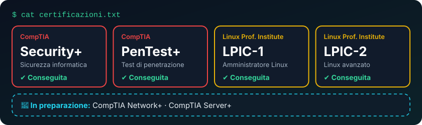
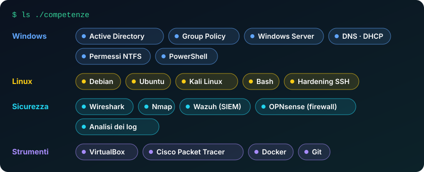

<p align="center">
  <b>Tecnico IT junior con focus sulla cybersecurity.</b><br>
  Costruisco laboratori che simulano un'azienda vera e documento ogni problema come un ticket: <b>cosa è successo, perché, come l'ho risolto</b>.
</p>

<p align="center">🎯 Obiettivo: <b>SOC Analyst / Blue Team</b> &nbsp;·&nbsp; 📍 Calabria, Italia &nbsp;·&nbsp; 🇬🇧 Inglese <b>C1</b> (Cambridge)</p>

---

## 🛡️ Certificazioni



## 💼 In pratica, cosa so fare per un'azienda

- 👥 **Gestire utenti e accessi** — creo account, gruppi e permessi in Active Directory, sblocco account e reimposto password
- 📋 **Configurare tutti i PC insieme** — con le Group Policy: unità di rete automatiche, restrizioni per gli utenti, regole di sicurezza
- 📁 **Organizzare il file server** — cartelle per reparto, accessibili solo a chi ne ha bisogno
- 🔧 **Risolvere i problemi** — PC che non accede al dominio, account bloccati, server che non si avvia: diagnosi, soluzione e verifica
- 🐧 **Mettere in sicurezza i server Linux** — accesso SSH protetto, firewall, controllo dei log
- 🔍 **Individuare attività sospette** — analisi del traffico di rete e dei log di sicurezza

## ⚙️ Competenze tecniche



## 🧪 Progetti

### 🏢 [acme-it-lab](https://github.com/dstaropolisec/ACME-IT-LAB) &nbsp;`✅ online`

Un'azienda simulata — **ACME S.r.l., sede di Catanzaro** — con domain controller, postazione utente, reparti e policy. Alcuni problemi reali che ho risolto e documentato:

| Problema | Come l'ho risolto |
|---|---|
| 🔒 Un utente non riesce più ad accedere | Trovato **da quale PC** arrivavano i tentativi errati (evento 4740) e sbloccato l'account |
| 💥 Il server principale non si avvia più | Individuato il file danneggiato, ripristinato lo snapshot e verificato il dominio con `dcdiag` |
| 🔗 Un PC "non si fida più" del dominio | Riparato il collegamento senza togliere il PC dal dominio e senza perdere i profili |

### 🔜 In arrivo

- 🐧 **linux-security-lab** — mettere in sicurezza un server Linux e rilevare un attacco brute force
- 🔵 **home-soc-lab** — un piccolo centro di monitoraggio con Wazuh (SIEM) e firewall OPNsense

## 📡 Stato attuale

```text
dstaropolisec@soc-lab:~$ cat status.log
[ OK ]  Active Directory · GPO · file server     → acme-it-lab
[RUN ]  AppLocker e Windows LAPS                 → prossimo lab
[RUN ]  CompTIA Network+ · Server+               → in preparazione
[NEXT]  Home SOC con Wazuh e OPNsense
[GOAL]  SOC Analyst L1 · Blue Team
```

## 🎓 Formazione

- 💻 Laurea in Informatica (L-31) — in corso
- ⚓ Diploma a indirizzo nautico

---

<p align="center"><sub>📫 Contatti su LinkedIn o via email (indirizzo sul CV)</sub></p>
